<div align="center">

<picture>
  <source media="(prefers-color-scheme: dark)" srcset="assets/banner.svg">
  <source media="(prefers-color-scheme: light)" srcset="assets/banner-light.svg">
  
</picture>

[](LICENSE)
[](#安装)
[](#安装)
[](#安装)
[](https://uniqai.app/?utm_source=github&utm_medium=readme-zh-cn&utm_campaign=no-plastic)

**修复 AI 人像的塑料感皮肤和假脸：提示词规则、编辑锁定和一个 linter。**

[快速开始](#快速开始) · [工作原理](#工作原理) · [示例](#示例) · [安装](#安装) · [FAQ](#faq)

</div>

[English](README.md) · [Русский](README.ru.md) · 简体中文 · [Español](README.es.md) · [Português (BR)](README.pt-BR.md) · [日本語](README.ja.md) · [한국어](README.ko.md)

# no-plastic：修复 AI 人像的塑料感皮肤和假脸

AI 人像看起来假，原因就那么几个：皮肤没有毛孔、脸左右完全对称、光不知道从哪来、虚化像涂上去的、青橙色调、没有颗粒。每一条都是模型的默认行为，每一条也都有一句话可以覆盖它。no-plastic 是一个 Claude Code 技能（附 Cursor 和 Codex 适配器），它把你的图片提示词改写成一份包含这些句子的摄影简报，写出只改一处、保留人物本身的编辑提示词，并附带一个零依赖的 linter，按检查清单给任何提示词打分。面向 Flux、Nano Banana、Midjourney 和 SDXL 编写；用的是摄影词汇，所以换到下一代模型照样适用。

| **写简报，不堆标签** | **保住脸的编辑** | **渲染之前先 lint** |
|:---|:---|:---|
| 主体、构图、相机、光线、色调、质感、年代、否定项：八个字段，三到五句话，反塑料感规则已经揉在里面。 | 一处改动加四道锁（身份、真实感、构图、接缝），并提供移除、换背景、换服装、换发型、增强和自拍转职业头像的模板。 | `scripts/lint_prompt.py` 给覆盖度打分，标出会导致塑料感的词，并为缺失项打印一份简报骨架。仅用 Python 3 标准库。 |

## 快速开始

```bash
git clone https://github.com/uniqaiapp/no-plastic ~/.claude/skills/no-plastic
cd ~/.claude/skills/no-plastic
python3 scripts/lint_prompt.py examples/01-linkedin-headshot/before.txt examples/01-linkedin-headshot/after.txt
```

你会看到第一条提示词（“professional headshot of a beautiful woman, perfect skin, 8k...”）得分 0/100，并列出拖垮它的那些词；改写后的简报得分 100/100。然后在 Claude Code 中输入 `/no-plastic` 并粘贴一条提示词，或者直接说“这张看着像塑料”并附上提示词。

## 演示



## 工作原理

1. **分类。** 一条*生成*提示词（文生图），还是一条*编辑*提示词（对已有照片的指令：移除、换服装、增强、自拍转职业头像）。linter 根据开头的动词自动判断。
2. **Lint。** `python3 scripts/lint_prompt.py --brief prompt.txt` 打印八字段简报，填入找到的措辞，提示词没提到的地方标 `?`；普通报告则列出被标记的词（`8k`、`masterpiece`、`flawless skin`、`cinematic lighting`、标签堆砌、SD1.5 时代的否定提示词套路）以及每个词的代价。
3. **点评并改写。** 技能用摄影术语指出三个最大的缺口，然后把提示词改写成简报：主体和动作；构图；相机和光线；色调、质感和年代；否定项。反塑料感规则始终在里面：`natural skin texture with visible pores`、`slight asymmetry`、一个有名字、有衰减的光源、`fine film grain`、`not over-processed, no retouched plastic look`。
4. **按模型调整。** Flux 和 Nano Banana 拿到的是散文式描述，要避免的东西用肯定句式表达（它们会忽略否定列表）；Midjourney 拿到 `--style raw`、较低的 `--stylize` 和一个简短的 `--no`；SDXL 拿到的简报把主体、光线和质感放在前 77 个 token 内，外加一个简短的否定字段。见 [references/model-notes.md](references/model-notes.md)。
5. **先试渲，再批量。** 渲染一张，做五秒检查（100% 放大看额头质感、鼻影、眼神光、发际线、背景衰减），修简报而不是反复抽卡，然后再渲染整组。这就是 UniqAI 为自己网站制作插图时用的流程；[references/pilot-review.md](references/pilot-review.md) 里有任务清单格式和判定规则。

```
loose request ──▶ lint (gaps + flags) ──▶ brief / edit with locks ──▶ per-model variant ──▶ re-lint ≥ 85 ──▶ pilot ──▶ review ──▶ batch
```

本 README 中的分数均由 `python3 scripts/lint_prompt.py` 在 `examples/` 下的文件上生成；若有偏差，`tests/test_examples.py` 会失败。linter 读的是文字，不是像素：100 分意味着简报完整，不意味着图一定好。试渲就是为此而存在的。

## 示例

[examples/](examples/README.md) 中有九组对比及报告。这里完整展示其中两组：

<details open>
<summary><b>职业头像：“8k masterpiece” → 85 mm 简报（0 → 100）</b></summary>

**改前**（`examples/01-linkedin-headshot/before.txt`，得分 0/100）

```text
Professional headshot of a beautiful woman, perfect skin, studio lighting, 8k, ultra realistic, masterpiece, sharp focus
```

**改后**（`examples/01-linkedin-headshot/after.txt`，得分 100/100）

```text
Head-and-shoulders business headshot of a woman in her early fifties with pale skin, a silver-grey bob and small hoop earrings, wearing a dark tailored blazer over a white top, a small relaxed smile, shoulders turned slightly off camera. A bright modern office with glass partitions and plants blurred softly behind her, face in the upper two thirds of a vertical frame. The look of an 85 mm lens at f/2.8: one large soft key light from camera left with a gentle fill and a subtle rim on the hair, clean catchlights, crisp focus on the eyes. Clean neutral daylight with no colour cast. Natural skin texture with visible pores and fine lines, a few flyaway hairs, no retouched plastic look, not over-processed.
```

</details>

<details>
<summary><b>编辑：“把背景里那个人去掉” → 带锁定的移除（5 → 100）</b></summary>

**改前**（`examples/07-edit-remove-stranger/before.txt`，得分 5/100）

```text
Remove the guy in the background
```

**改后**（`examples/07-edit-remove-stranger/after.txt`，得分 100/100）

```text
Remove the stranger walking in the background behind her shoulder and fill the space with matching sand, sea and sky so nothing looks patched. Keep the woman, her pose, the lighting and everything else exactly as they are. Output the full original frame at exactly the same zoom and position; do not crop, zoom in or recompose. Do not change the framing, crop, camera angle, or anything not mentioned. The result must look like an untouched real photograph, with no smudges, repeated textures, halos or visible seams.
```

</details>

<details>
<summary><b>这样的简报能出什么图</b></summary>

UniqAI 用这种方式写简报为自己网站生成的插图（没有图库照片，没有真人；模型和提示词作为来源信息保留）。左：一条带质感句和否定句的生成简报。中、右：一组编辑对比，在身份和构图锁定下只换了发型，其他全部保留。

| 生成简报 | 编辑：改前 | 编辑：改后 |
|:---:|:---:|:---:|
|  |  |  |
| `...50 mm lens at f/2, soft natural light, gentle filmic colour grade with creamy highlights and slightly lifted blacks, natural skin texture with visible pores, no retouched plastic look.` | `...85 mm lens at f/4, large soft window light from camera left with a gentle fill, warm off-white seamless backdrop, natural skin texture...` | `Change her hairstyle to a chin-length curtain bob... Keep her face, skin, expression, clothes, the background and the light exactly as they are... no smudges, repeated textures, halos or visible seams.` |

</details>

## 安装

任何会读取指令文件的代理都能用，选你的那个即可。要求：linter 需要 Python 3.9+，无需安装任何包。

<details open>
<summary><b>Claude Code</b></summary>

```bash
# user-level (available in every project)
git clone https://github.com/uniqaiapp/no-plastic ~/.claude/skills/no-plastic
# or project-level
git clone https://github.com/uniqaiapp/no-plastic .claude/skills/no-plastic
```

之后在任意会话中输入 `/no-plastic`，或者直接描述任务；技能的 `description` 会自动触发它。接受 `owner/repo` 形式的技能目录 CLI 也可以：`npx skills add uniqaiapp/no-plastic`。作为插件使用（待 uniqaiapp 市场发布后）：先 `/plugin marketplace add uniqaiapp/skills`，再 `/plugin install no-plastic@uniqaiapp`。

</details>

<details>
<summary><b>Cursor</b></summary>

把 `SKILL.md`、`scripts/`、`references/` 和 [`.cursor/rules/no-plastic.mdc`](.cursor/rules/no-plastic.mdc) 复制到你的项目中。规则文件通过 `@SKILL.md` 内嵌整个技能。

</details>

<details>
<summary><b>Codex / 任何读取 AGENTS.md 的代理</b></summary>

把 `SKILL.md`、`scripts/` 和 `references/` 复制到 `.agents/skills/no-plastic/`，再把 [`codex/INSTRUCTIONS.md`](codex/INSTRUCTIONS.md) 中的片段加到你的 `AGENTS.md` 里。本仓库自带的 [`AGENTS.md`](AGENTS.md) 是通用版本。

</details>

<details>
<summary><b>纯提示词，或者完全不用代理</b></summary>

把 [`SKILL.md`](SKILL.md) 粘贴到任意模型的系统提示词中；除 frontmatter 外它没有任何代理专属语法。[`references/checklist.md`](references/checklist.md) 中的检查清单纸面上就能用，linter 也能独立运行：

```bash
python3 scripts/lint_prompt.py --help
echo "portrait of a woman, 8k, flawless skin" | python3 scripts/lint_prompt.py -
python3 scripts/lint_prompt.py --strict --min-score 70 prompts/*.txt   # exit 1 if any prompt is below 70
```

</details>

## FAQ

<details>
<summary><b>为什么提示词里写了“realistic”，AI 人像还是一股塑料感？</b></summary>

因为“realistic”“photorealistic”和“8k”这些标签来自训练数据里渲染图和 CGI 的那一角，不是来自照片的说明文字。它们会把结果拉向自己原本附着的那种外观。照片的说明文字写的是镜头、光线和胶片，所以这才是把你带到摄影这一边的词汇：`85 mm at f/2.8`、`window light from camera left`、`fine film grain`、`natural skin texture with visible pores`。

</details>

<details>
<summary><b>“smooth skin, airbrushed”这样的否定提示词有用吗？</b></summary>

在 SDXL 和 Midjourney（`--no`）上有用，前提是它够短，而且写的是你真的见过的某种外观。Flux 和 Nano Banana 没有否定字段；结尾挂一串列表会被忽略。把同样的意思用散文写进最后一句：`natural skin texture, no retouched plastic look, not over-processed`。从 SD1.5 继承下来的那串（`bad anatomy, extra fingers, worst quality...`）对当前模型毫无作用，linter 会把它标出来。

</details>

<details>
<summary><b>linter 能告诉我图会不会看起来真实吗？</b></summary>

不能。它读的是提示词，不是像素。100 分表示简报覆盖了八个字段，且不含任何已知的问题词。渲染效果好不好取决于模型、种子和参数，所以技能的最后一步才是先渲染一张、用五秒检查法审一遍。

</details>

<details>
<summary><b>编辑照片时怎样保证还是同一个人？</b></summary>

把必须保留的东西逐一点名，并写上“exactly as they are”：`Keep the face, features, skin tone, hair edges, expression and identity exactly as they are`，然后锁定画面：`Do not change the framing, crop, camera angle, or anything not mentioned`。最容易漂移的三样是两眼间距、发际线和背景曝光；哪一样动了，就把它写进锁定句再跑一次。各类编辑的模板见 [references/edit-prompts.md](references/edit-prompts.md)。

</details>

<details>
<summary><b>那把人修得更年轻或更瘦呢？</b></summary>

那是修图，而这些规则的方向正好相反。技能会拒绝对真人“变好看”的要求，转而提供诚实的版本：更好的光线、更长的焦距、更干净的背景。未经本人同意，请勿用它编辑他人照片。

</details>

## 限制与诚实说明

- 基于正则，仅支持英文。linter 不认识的同义词会被算作缺失；欢迎补充并提 PR。
- 模型说明来自我们自己插图制作过程中的观察，不是基准测试。没有图片数量，没有“真实感提升 X%”。版本会变，请重新试渲。
- 本 README 中唯一的数字就是 lint 分数，可用 `python3 scripts/lint_prompt.py examples/*/before.txt examples/*/after.txt` 复现。
- 如果你就是想要杂志修图那种效果，技能会告诉你它放弃了哪些规则，而不是默默套用检查清单。

## 相关项目

- [video-director](https://github.com/uniqaiapp/video-director)：把一句话创意变成 AI 视频模型（Kling、Veo、Sora 等）的分镜提示词，附带镜头、灯光和运动词汇。同一套摄影词汇，用在动态画面上。
- [awesome-ai-video-prompts](https://github.com/uniqaiapp/awesome-ai-video-prompts)：精选并分类的 AI 视频模型提示词，附带生成时所用的参数。
- [skill-shrinker](https://github.com/uniqaiapp/skill-shrinker)：压缩任何 SKILL.md 或代理指令文件；本仓库的 references/ 布局就遵循了它的建议。

想要一个保留毛孔的增强工具？同一套规则驱动着 [UniqAI 照片增强器](https://uniqai.app/tools/upscaler-enhancer?utm_source=github&utm_medium=readme-zh-cn&utm_campaign=no-plastic)。

## 参与贡献

欢迎提 issue 和 pull request。改动尽量小，并在 PR 描述中附上一组改前/改后的提示词。本地检查方式见 [CONTRIBUTING.md](CONTRIBUTING.md)（`python3 tests/run.py`，无依赖）。

## 许可证

[MIT](LICENSE) © UniqAI

---

<div align="center">

<sub>由 <a href="https://uniqai.app/?utm_source=github&utm_medium=readme-zh-cn&utm_campaign=no-plastic">UniqAI</a> 出品 — Kling 3.0、Veo 3、Flux、Nano Banana 和 GPT-5/Claude/Gemini/Grok，集成在一个应用里。这些规则最初是为了制作我们自己网站的插图而写的，后来就一直用了下来。</sub>

</div>
